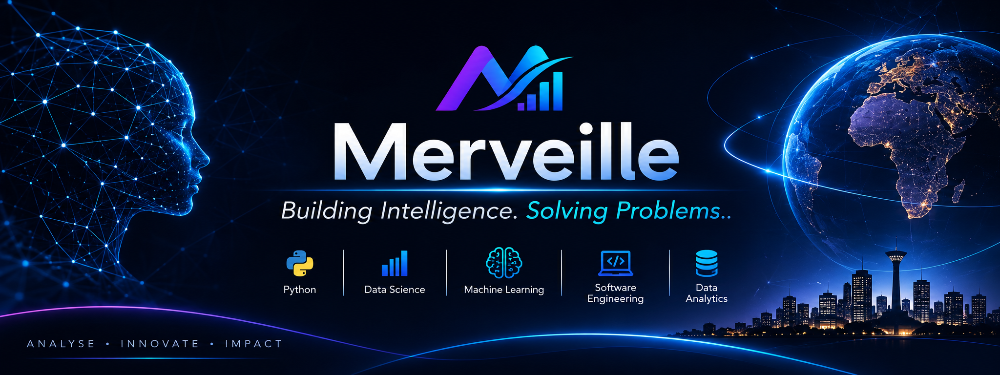

# 👋 Hello, I'm Merveille!

  

### Software Engineer | Machine Learning Enthusiast | Data Science & Applied AI

**Turning data into insights. Turning ideas into intelligent solutions.**

I'm a Software Engineering graduate specializing in Machine Learning, interested in building technology that solves real-world problems.

My interests lie at the intersection of **Data Science, Machine Learning, and Software Engineering**. I enjoy exploring data, developing predictive models, and building applications that turn technical ideas into practical solutions.

I'm particularly interested in applying AI to areas such as healthcare, where technology can make services more accessible and improve decision-making.

---

## 🧭 What I'm interested in

- 📊 **Data Science:** Exploratory data analysis, statistical analysis, predictive analytics and extracting meaningful insights from data.
- 🤖 **Machine Learning & AI:** Classification, predictive modelling, model evaluation and applied AI.
- 💻 **Software Engineering:** Building functional, scalable and user-centered applications.
- 🧠 **Continuous Learning:** Exploring Large Language Models (LLMs), intelligent systems and new approaches to solving problems with data.

---

## 🛠️ My Tech Stack

**Languages**

**Data Science & Machine Learning**

**Software Development**

---

## 🚀 Featured Projects & Current Work

### 📊 Data Science & Machine Learning

| Project | Focus |
|---|---|
| [Customer Churn Analysis & Prediction](https://github.com/YOUR-USERNAME/customer-churn-analysis) | Customer behaviour analysis, exploratory data analysis and predictive modelling. |
| [Retail Sales & Business Performance Analysis](https://github.com/YOUR-USERNAME/retail-sales-analysis) | Sales trends, business performance, revenue analysis and data-driven insights. |
| [E-commerce Analytics Using SQL](https://github.com/YOUR-USERNAME/ecommerce-sql-analysis) | Relational databases, SQL queries, customer analytics and business intelligence. |
| [Nairobi Air Quality Analysis](https://github.com/YOUR-USERNAME/nairobi-air-quality-analysis) | Environmental data analysis, time-series exploration and forecasting. |
| [Bankruptcy Risk Classification](https://github.com/YOUR-USERNAME/bankruptcy-risk-classification) | Financial data analysis, imbalanced classification and predictive risk modelling. |

### 🧠 Applied AI & Healthcare

| Project | Focus |
|---|---|
| [MamaSafe – GDM Risk Prediction](https://github.com/YOUR-USERNAME/mamasafe-gdm-prediction) | Applying machine learning to gestational diabetes risk prediction and maternal healthcare support.

*Projects are at different stages of development. More details, visualizations and implementation updates will be added as they progress.*

## 🌱 Currently Exploring

- Advanced predictive modelling and model interpretation.
- SQL for data analysis and business intelligence.
- Large Language Models and practical AI applications.
- Building data-driven solutions for real-world challenges.

---

## 🎓 A Little About My Journey

My background is in Software Engineering, with a focus on Machine Learning. I also hold a Data Science Modeling certificate from WorldQuant University.

I believe that technology is most meaningful when it goes beyond the code and creates value for people. This belief continues to shape the projects I choose, the skills I develop and the problems I want to solve.

---

## 🤝 Let's Connect!

I'm always interested in connecting with people working in Data Science, Machine Learning, AI and Software Engineering.

**Always learning. Always building. Always looking for better ways to solve problems.**

